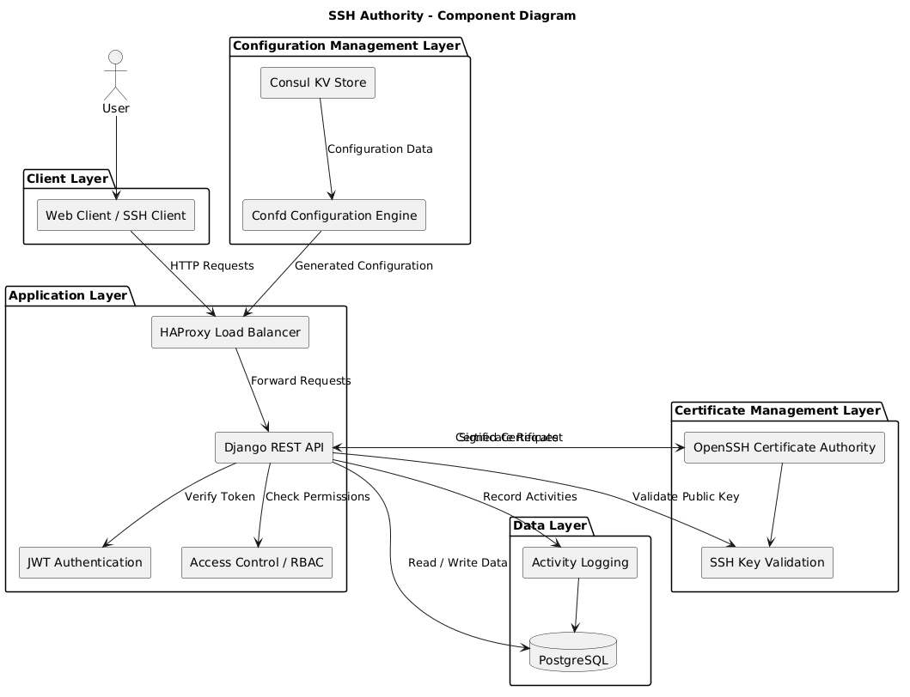
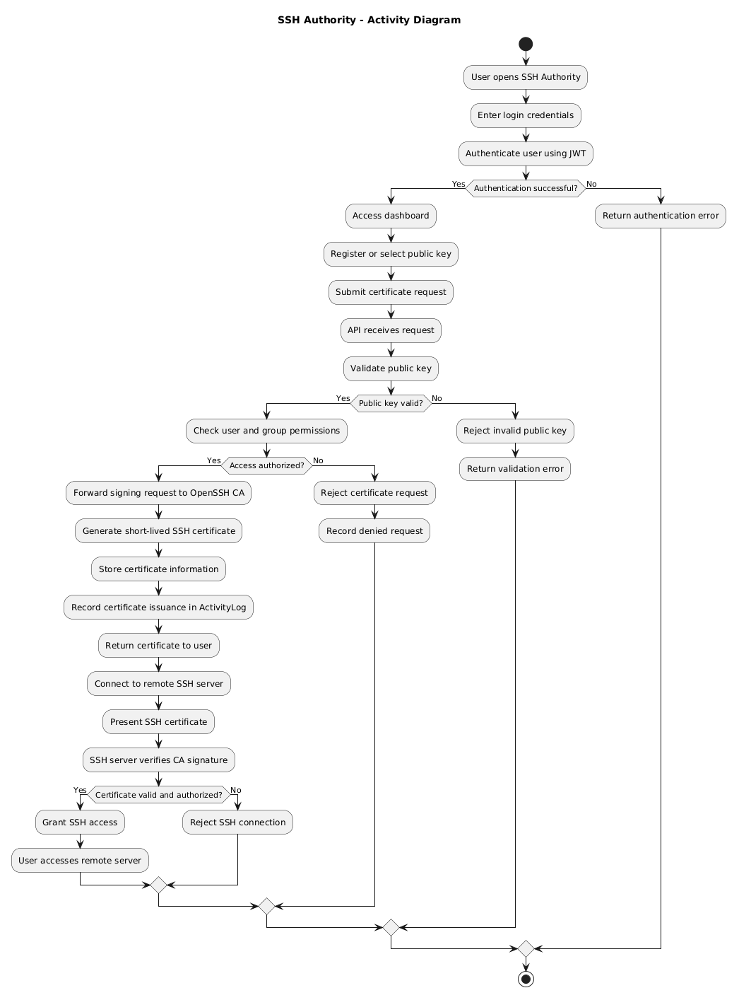
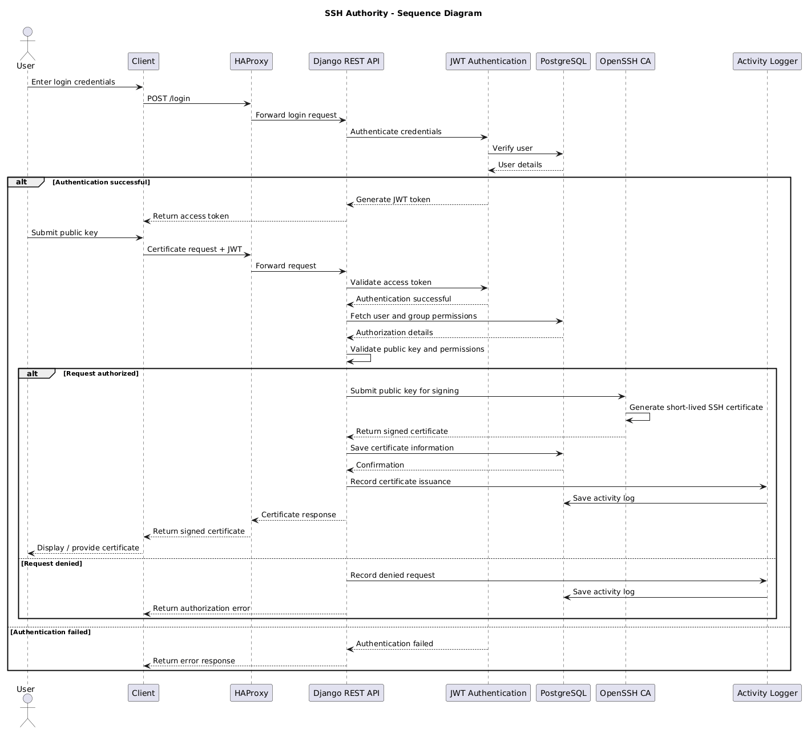
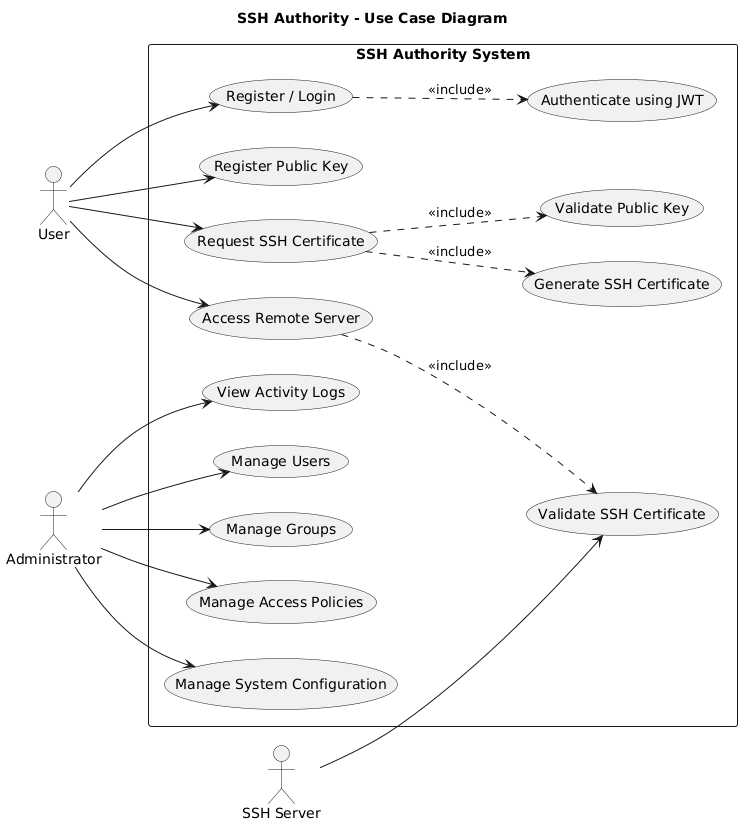
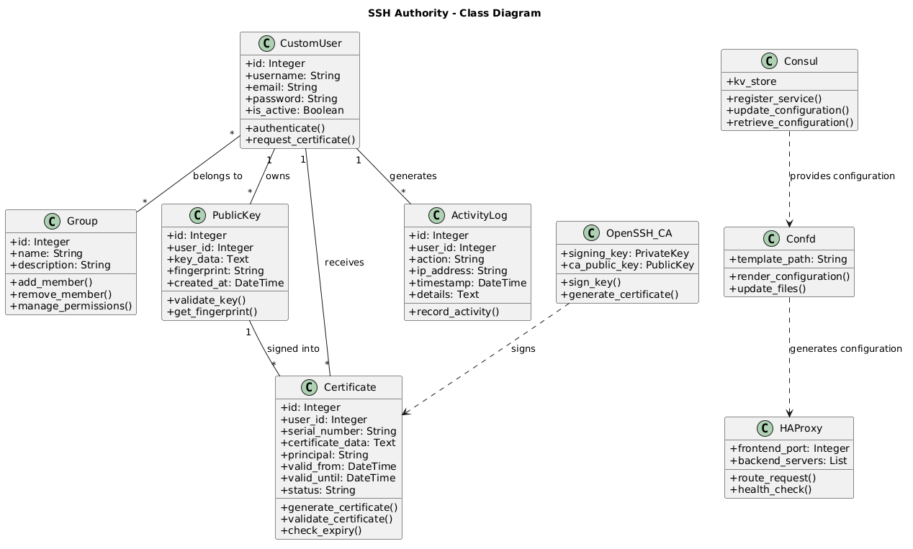
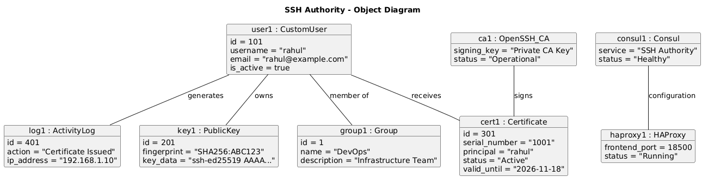

# SSH Authority

SSH Authority is a policy-driven SSH user-certificate service. It provides a Django web application and API for user registration, group/role management, public-key submission, and certificate requests. OpenSSH `ssh-keygen` signs user keys with a CA key; the project also includes a Docker-based CA container, Consul configuration, HAProxy configuration, and a Consul file-sync utility.

> Status and deployment note: The repository contains application code and infrastructure examples, but the checked-in Compose file does not run the Django application or a database. The Django app needs PostgreSQL, and its certificate-signing code needs access to the Docker daemon and the `certificate-authority` container. Configure and test these dependencies before using this project with real credentials. The included Consul ACL configuration uses `default_policy = "allow"` and is not suitable for production.

## Architecture

The web application stores users, groups, public keys, and issued certificate records in PostgreSQL. An authenticated user submits a public key and requests signing; the app copies the key into the CA container, invokes `sign.sh`, and returns the resulting OpenSSH certificate. Consul/Confd and HAProxy are included for configuration distribution and service access; they are separate from the Django app's database and signing path.

## Diagrams

These diagrams are part of the repository and can be viewed directly in the `Diagrams/` directory.

### Component diagram



### Activity diagram



### Sequence diagram



### Use-case diagram



### Class diagram



### Object diagram



## Requirements

- Docker Engine and the Docker Compose plugin, for the supplied infrastructure containers.
- Python 3.10 or later and `pip`, to run the Django application on the host. The included Dockerfile also builds the app image, but there is no app service in `docker-compose.yml`.
- PostgreSQL reachable from the machine running Django.
- OpenSSH client tools (`ssh-keygen`) in the CA container; the supplied CA image provides them.

## 1. Get the code

```bash
git clone https://github.com/mradulnatani/SSH-authority.git
cd SSH-authority
```

## 2. Start the supporting containers

The Compose file defines a five-server Consul cluster, a CA container, and an HAProxy frontend. Start those services explicitly:

```bash
docker compose up -d consul1 consul2 consul3 consul4 consul5 certificate-authority consul-lb
docker compose ps
```

Consul's UI/API is exposed at http://localhost:8500 and the HAProxy frontend at http://localhost:18500. The CA container is named `certificate-authority`; the app's signing code uses that exact Docker container name.

The CA generates its key pair under `./ssh-ca` when it first starts. Keep the private key (`ssh-ca/id_rsa`) secret, restrict access to that directory, and back it up securely. The Compose file mounts the directory so the CA key persists across container recreation. Do not commit the private key.

> The optional `consul-sync` Compose service currently runs `consul_sync.py` without its required `--file`, `--kv-key`, and `--token` arguments, so it will not start successfully as configured. Configure those arguments and an appropriately scoped Consul ACL token before using the sync utility. Do not use the example ACL policy for a production deployment.

## 3. Configure PostgreSQL and Django

Create a PostgreSQL database and user, then create `webtool/.env` with values for the settings read by `webtool/webtool/settings.py`:

```dotenv
SECRET_KEY=replace-with-a-long-random-django-secret
JWT_SIGNING_KEY=replace-with-a-separate-long-random-secret
DATABASE_NAME=ssh_authority
DATABASE_USER=ssh_authority
DATABASE_PASSWORD=replace-with-a-database-password
DATABASE_HOST=127.0.0.1
DATABASE_PORT=5432
```

Generate secrets rather than using the example text; for example, use Python's `secrets` module to generate random values. Do not commit `.env`. The settings currently hard-code `DEBUG = True` and `ALLOWED_HOSTS = ['*']`; change these for any deployment beyond local development.

Install the application dependencies and apply database migrations:

```bash
python3 -m venv .venv
source .venv/bin/activate          # Windows: .venv\Scripts\activate
python -m pip install --upgrade pip
python -m pip install -r webtool/requirements.txt
cd webtool
python manage.py migrate
python manage.py createsuperuser
```

The settings use PostgreSQL, so a reachable database must be available before running migrations. The root `requirements.txt` is not needed for this Django setup; use `webtool/requirements.txt`.

## 4. Run the web application

From the `webtool` directory, with the virtual environment active and PostgreSQL running:

```bash
python manage.py runserver 127.0.0.1:8001
```

Open http://127.0.0.1:8001/ for the web interface or http://127.0.0.1:8001/admin/ for Django admin. The repository's Dockerfile starts uWSGI on port `8001`, but it does not provide a Compose service, PostgreSQL, or Docker-daemon access for the app; configure those separately if you choose to run the app in a container.

## 5. Typical certificate flow

1. Register/sign in through the web app or the API and associate the user with an appropriate group.
2. Submit the user's public SSH key to `POST /api/pub-key/` using a JWT bearer token.
3. Request signing through `GET /api/keysign/` with the same authentication. The app invokes the CA container and returns an OpenSSH user certificate.
4. Install the CA public key on SSH servers and configure `sshd` to trust it. For user certificates, configure `TrustedUserCAKeys` to point to the installed CA public key; review `AuthorizedPrincipalsFile` or `AuthorizedPrincipalsCommand` to restrict the principals each account accepts.
5. Use the certificate alongside its matching private key to connect. Inspect a certificate with `ssh-keygen -L -f <certificate>-cert.pub`.

The signing script sets a one-day validity period and uses the identity and principals supplied by the app. Short-lived certificates reduce exposure, but they do not replace protecting the CA private key or enforcing server-side principal policy.

### API routes

Routes are defined in `webtool/webtool/urls.py`. Relevant endpoints include:

| Method | Path | Purpose |
| --- | --- | --- |
| `POST` | `/api/register/` | Register a user |
| `POST` | `/api/token/` | Obtain JWT access and refresh tokens |
| `POST` | `/api/token/refresh/` | Refresh a JWT |
| `POST` | `/api/pub-key/` | Submit an SSH public key (authenticated) |
| `GET` | `/api/keysign/` | Request signing of the latest unsigned key (authenticated) |
| `GET` | `/api/certificates/` | List the signed-in user's certificates (authenticated) |
| `GET` | `/api/get-user/` | Get the signed-in user's profile (authenticated) |
| `POST` | `/api/logout/` | Blacklist a refresh token (authenticated) |
| `GET` | `/api/groups/` | List groups |

Send authenticated requests with `Authorization: Bearer <access-token>`. Consult the application code before exposing endpoints: configuration and access-control behavior may need additional hardening.

## Consul file-sync utility

`consul_sync.py` watches a local file and writes its contents to a Consul KV key when it changes. It requires an absolute existing file path, Consul URL, KV key, and ACL token:

```bash
python consul_sync.py \
  --file /absolute/path/to/file \
  --consul-url http://localhost:8500 \
  --kv-key path/to/key \
  --token <consul-acl-secret-id> \
  --interval 2
```

Use a narrowly scoped Consul token and protect it as a secret. The checked-in `consul-config/acl.hcl` has an allow-all default policy and should be replaced with a least-privilege policy before enabling ACLs in a real environment.

## Configuration and security checklist

- Keep `ssh-ca/id_rsa`, Django `SECRET_KEY`, `JWT_SIGNING_KEY`, database credentials, and Consul ACL tokens out of source control.
- Replace the sample Consul ACL policy; limit access to the Consul UI/API and avoid exposing it publicly.
- Set Django `DEBUG = False`, use a specific `ALLOWED_HOSTS` list, and configure HTTPS and secure cookie/proxy settings for deployment.
- Restrict who can register, assign groups, upload keys, and request signatures. Validate the principals and identity that are signed.
- Install only the CA public key on SSH servers and configure principal allowlists. Never distribute the CA private key.
- Verify how certificate expiry and revocation are enforced. The app records revocation metadata, but OpenSSH servers do not automatically consult this application's database; short lifetimes and server-side policy remain important.
- Review and test the checked-in Compose, Consul, HAProxy, and application configuration for your environment before production use.

## Repository map

- `webtool/` — Django application, UI, authentication API, models, and database settings.
- `sign.sh` — invokes `ssh-keygen` using the CA private key mounted in the CA container.
- `docker-compose.yml`, `Dockerfile` — infrastructure stack and application image recipe.
- `consul-config/`, `consul_sync.py`, `run_confd.sh`, `haproxy.cfg` — Consul/Confd configuration and related utilities.
- `Diagrams/` — project design diagrams embedded above.
```

